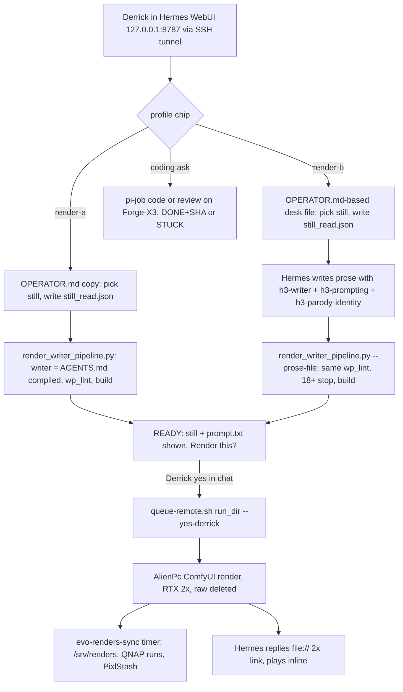

# Hermes direct H3 render on EVO-X3: two side-by-side paths

Status of this file: PLAN ONLY. Nothing below has been applied on the X3. Derrick wants another AI to verify it before any `ce-work` run (t2607u). Labels: VERIFIED = re-checked live on the X3 or in source/docs on 2026-11-19 between 9:37 and 9:50 AM CT; ASSUMPTION = not proven, must be tested in the unit that relies on it.

---

## Goal Capsule

| Field | Value |
|---|---|
| Objective | Derrick asks for a clip in a Hermes chat he can see; Hermes renders it directly on the X3 (no pi hop), shows still + prompt, queues only on his yes in that chat, and the 2x video plays inline. Two ways are built and compared side by side: Path A (our pipeline writes the prompt) and Path B (Hermes writes the prompt, community style, our checks gate it). |
| Also | Hermes stays the entry point for coding jobs: it hands code/review work to pi through the existing `pi-job code|review` (Forge) and keeps doing that after the test (t2609u). |
| Authority | Derrick t2598u (Hermes WebUI yes, no pi hop), t2600u (same agreed rules as Render, NSFW parody accepted, all templates), t2602u (everything in the right place), card t2603s9268 ("Set up both and test them side by side in my Hermes chat"), t2607u (plan file, push Gitea + GitHub + brain), t2609u (keep pi coding hand-off), t2610u (everything on GitHub for review). |
| Execution profile | One device (EVO-X3), user-level changes as `evo`, under the X3 lease, every change backed up to `_archive` first with a written rollback. |
| Stop conditions | Any unit test fails twice; any rule in "Hard constraints" would be bent; a render is active on AlienPc when a llama-swap/Hermes restart is needed; Derrick says hold. |
| Who finishes | Max does U0-U9 himself (no agy hand-off needed; it is config + one small flag). Derrick: types the WebUI password into the locked X3 key file, gives the test asks and every render yes in his WebUI chat, picks the winner, says yes to retiring the pi-job render part. |

## One-page summary

What Derrick gets: a Hermes WebUI page on the X3 (127.0.0.1:8787, reached by SSH tunnel) with two Hermes profiles in the profile picker: `render-a` (pipeline) and `render-b` (community). Same ask, both ways, in his own visible chat. Each profile picks the still exactly like Render (OPERATOR.md step 1-2), shows the still and the full prompt, asks "Render this?", and only after his yes runs `queue-remote.sh <run_dir> --yes-derrick`. That command already renders on AlienPc ComfyUI, makes the RTX 2x, deletes the raw clip (t2571u), and the `evo-renders-sync.timer` (every 2 min) publishes only the 2x to `/srv/renders`, the QNAP runs share and PixlStash. Hermes replies with a `file://` link to the 2x so WebUI plays it inline. No ntfy code on this path. Coding asks in either profile go to `pi-job code|review` (Forge-X3) and come back as DONE + commit or STUCK.

The two paths differ only in who writes the H3 prompt:
- Path A, pipeline (what Render does today): Hermes's project instructions are a copy of `render/OPERATOR.md`; it loads only `h3-parody-identity` + `h3-prompting`; it runs the ONE command `render_writer_pipeline.py`, whose writer call is driven by the 54 KB `render/AGENTS.md` (compiled to `writer_prompt.md`) and checked by `wp_lint` + the builder.
- Path B, community: Hermes writes the prompt itself from an `h3-writer` skill built from `render/AGENTS.md` (skill, not SOUL), plus the same two H3 skills; it saves the prose and runs the same pipeline with one new flag `--prose-file` that skips the writer model and runs the SAME lint, 18+ hard stops, template fill and build checks as the one gate before the yes.

Shared base for both: Hermes WebUI install (MIT), stock `SOUL.md`, Derrick's OC facts in `memories/USER.md`, approval wait 300 s, turn limit 80, reasoning effort `low` everywhere, PixlStash read key loaded from the existing token file (never copied), and a `pi-job` skill that keeps code/review and drops render in the two render profiles.

Three things the live check changed versus the chat brief (all VERIFIED, details in Planning Contract):
1. A symlink `AGENTS.md -> render/OPERATOR.md` would be SKIPPED by Hermes (targets outside the working folder are ignored), so the desk file is a copy with a hash drift check, not a link.
2. Two paths coexist as two Hermes profiles; Hermes WebUI has a per-chat profile picker. The default profile (Derrick's current Open WebUI chat) stays as is.
3. Hermes WebUI's default mode runs the agent in-process from `HERMES_HOME` (community default) and shows approval cards; its gateway mode needs an extra runs-API opt-in for approval cards. Plan uses the default in-process mode.

Win rule (numeric): after the same 3 asks run both ways, Path B wins only if it has 3/3 READY-first-try with 0 hard-stop or gate misses AND Derrick prefers it in at least 2 of 3; otherwise Path A stays. Then after 3 good renders on the winner, the pi-job render part is retired only on Derrick's yes.

Community way: Hermes users give Hermes an H3 prompt skill and let it fill and queue a ComfyUI workflow (benjiyaya/Minimax-H3-Prompt-AgentSkill, 2026-08-06; r/StableDiffusion "Hermes Agent + ComfyUI MCP + MiniMax prompts", 2026-08-28; official Hermes `creative/comfyui` skill) → adapt: Path B copies this (prompt skill, Hermes writes); Path A keeps our pipeline; both keep our own queue/upscale/publish and our gate because the free-writing model broke saved rules earlier this month. The official comfyui skill and a ComfyUI MCP are not installed (they would bypass the 18+ gate, the yes gate and the 2x-only publish).

---

## Product Contract

### Problem Frame

Today a render ask in Hermes goes Hermes → `pi-job render` → pi (`render-pi.sh`, Render-X3) → back to Hermes, and the phone ntfy path still exists. Derrick wants Hermes set up "the way the community does" so it renders directly with no pi step (t2598u), with the exact same agreed rules as Render (t2600u), and wants to see both a pipeline version and a community version tested in his own chat (t2603s9268). Hermes also remains how he starts coding jobs, which go to pi (t2609u).

### Requirements

Content rules
- R1. 18+ is the only content stop. NSFW parody is accepted. Every person is an adult. Pass: both paths return `NOT_READY` with an 18+ reason for an ask carrying a youth cue (`youth_hint` / `scale_adult` / `_MINOR_RE`), and READY for an accepted adult parody ask. Gate: `wp_lint` hard stops (both paths). Owner: Max.
- R2. Parody, spoof, talk, OC guide/ref, two-person and long continuation all work, with every template. Pass: each of `named_parody`, `talk`, `oc_guide`, `oc_ref`, `two_person`, `long_continuation`, `plain` reaches READY on at least one dry ask per path; the other 9 templates (b2 family, ref2va_16x9, flux stills) stay selectable by the pipeline exactly as today (no template file changed). Gate: pipeline template router + build checks. Owner: Max.
- R3. Hermes gets the same agreed rules as Render, nothing dropped and nothing added: OPERATOR.md flow (still pick, one command, "Render this?", queue on yes) and only the two H3 skills Render loads. Pass: a new chat's system prompt (WebUI "context" view or `hermes -p render-a` prompt dump) shows the OPERATOR.md copy as the only project file, and the skill list shows `h3-parody-identity` + `h3-prompting` (+ `h3-writer` on Path B) and none of the 7 skills Render's launcher leaves out. Gate: Max read-back. Owner: Max.

Approval and output
- R4. Derrick's yes comes in his Hermes chat. Nothing is queued without it. Pass: a dry ask stops at "Render this?" with still + full prompt shown; `queue-remote.sh` refuses without `--yes-derrick`; Hermes only passes `--yes-derrick` on the turn right after his yes to that run. Gate: OPERATOR.md rule + `queue-remote.sh` refusal + Hermes approval card for the queue command. Owner: Derrick.
- R5. No ntfy phone code on the Hermes path. Pass: a full render through either path leaves the ntfy send log/pi-job job list unchanged (no `pi-job` job is created). Gate: Max check. VERIFIED today: `queue-remote.sh`, `run_queue.py`, `remote_upscale.py` contain no ntfy call; ntfy lives only in `/usr/local/bin/pi-job`.
- R6. Only the RTX 2x final is kept; the raw clip is deleted; the 2x is published to the QNAP runs share and PixlStash by the `evo-renders-sync` timer. Pass: after a render, `<run>/<tag>/render_ok.json` has an `upscale` block with `raw_deleted`, no `*_raw.mp4` exists, the clip is under `/mnt/qnap/renders/runs/<run>/<tag>/` and a new PixlStash entry exists (count only, never opened). Gate: existing `run_queue.py` (t2571u) + `/usr/local/bin/sync-renders`. Owner: Max.
- R7. The finished 2x plays inline in the Hermes WebUI chat, not as a paraphrase or a bare web link. Pass: Hermes's last message contains `file:///home/evo/AI/community/runs/<run>/<tag>/<clip>.mp4` and WebUI shows a video player. Gate: desk addendum + `MEDIA_ALLOWED_ROOTS`. Owner: Max.
- R8. Model is Halogen/llama-swap `flash-next-uncensored` with thinking low, same resident model as Render (zero GPU swaps). Pass: both profiles' `model.default` is the same alias the writer config uses, and `reasoning_effort` is `low` under both `model:` and `agent:`. Gate: config read-back. Owner: Max. See open issue O4 about the `-v2` alias.

Keys and safety
- R9. Keys only in the locked X3 key file or the existing token files, never new copies, never on a command line, never in chat or this plan. Pass: `rg` over the new files finds no key value; PIXL_KEY is exported at runtime from `~/.config/pixlstash/render-read.token` exactly like `render-pi.sh` line 23; the WebUI password is read from the locked X3 key file by the start wrapper; profile `.env` is not a new copy (see D1). Gate: Max + gitleaks pre-push. Owner: Max.
- R10. Each change is under the X3 lease, backed up to `_archive` first, with a rollback line. Pass: lease line present during work and cleared after; each touched file has a timestamped backup; the rollback table in U9 restores the default profile byte-for-byte. Owner: Max.

Coding hand-off (t2609u)
- R11. Hermes is the entry point for coding jobs and delegates code/review to pi through the existing `pi-job` (Forge-X3 at `/home/evo/AI/forge`). Pass: in Hermes WebUI (each render profile and the default profile), a coding ask starts `pi-job code <repo> "<task>"`, Hermes reports the job ID, waits with `pi-job wait`, and reports `DONE` with the new commit SHA or `STUCK`; a review ask starts `pi-job review`. Gate: pi-job skill + Derrick picks a harmless test task. Owner: Max.
- R12. Clear instructions say when to hand off to pi versus render directly: video/clip/render asks → render directly in Hermes (this plan); code changes, repo reviews, script/test fixes in a git repo → `pi-job code|review`; Hermes never edits Forge/Render/community code itself in a render profile. Pass: the desk addendum and the trimmed pi-job skill both state this in under 10 lines; a mixed test ("fix X in repo Y" vs "make a clip of Z") routes correctly in both profiles. Owner: Max.
- R13. Only the render part of pi-job retires, and only on Derrick's yes after 3 good renders on the winning path. `pi-job code|review|status|wait` stay. Pass: until that yes, the default profile's pi-job skill and `/usr/local/bin/pi-job render` are unchanged. Gate: Derrick's yes card. Owner: Derrick.

Setup shape
- R14. Hermes WebUI is installed as evo, bound to 127.0.0.1:8787, reached by SSH tunnel; Tailscale Serve only with Derrick's separate OK. Pass: `ss -ltnp` shows 127.0.0.1:8787 only; page opens over `ssh -L 8787:127.0.0.1:8787 evo-x3-1`; password prompt works. Gate: Derrick types the password. Owner: Max/Derrick.
- R15. SOUL.md is stock; Derrick's OC facts are in `memories/USER.md` (FCSydny and FCMegan are Derrick's fictional OCs, adults 18+, adult use fine). Pass: SOUL.md equals the pre-2026-11-19-09:16 backup; USER.md ≤ 1,375 chars, § separated, holds only those facts plus "Derrick" preferences already agreed. Owner: Max.
- R16. Approval wait 300 s, turn limit about 80. Pass: `approvals.timeout: 300`, `agent.max_turns: 80` in each profile; a render + wait loop finishes inside one turn budget. Owner: Max.
- R17. Both paths run side by side in Derrick's visible Hermes chat and are compared with a numeric win rule (Test protocol). Pass: Test protocol results table filled for 3 asks x 2 paths. Gate: Derrick picks. Owner: Derrick.
- R18. Everything lands in the right place (t2602u): run folders under `/home/evo/AI/community/runs/<run_name>`, desk files under `/home/evo/AI/hermes-desk/`, records in `~/evo-x3/records/hermes-direct-render/`, plan in the brain under `40_projects/hermes-direct-render/plans/`. Pass: U9 file inventory matches. Owner: Max.

### Scope Boundaries

- Not doing: installing the official `creative/comfyui` skill or any ComfyUI MCP; touching `llama-swap.yaml`; changing templates, `build_request.py`, `fill_request.py`, `acts.yaml`; changing `queue-remote.sh`, `run_queue.py` or `sync-renders`; Tailscale Serve; deleting `pi-job` or its render subcommand; changing Open WebUI (port 3000).
- Deferred: the community H3 rewriter Comfy node (pytraveler/MiniMax-H3-Prompt-Rewriter-ComfyUI) stays a separate todo; moving X3 keys to one file (todo x3-keys-onefile) stays separate, this plan only reads existing token files.

---

## Planning Contract

### Verified facts this plan rests on (re-checked 2026-11-19 ~9:40 AM CT)

| # | Fact | Where (VERIFIED) |
|---|---|---|
| F1 | Render chat launcher passes `--no-context-files`, `--skill $S/h3-parody-identity --skill $S/h3-prompting`, `--append-system-prompt ${RENDER_PROMPT_FILE:-$R/OPERATOR.md}` and `"You are Render-X3 on evo-x3."`, thinking `low`, extensions permission-system, loop-guard, auto-continue (plus cc-safety-net, pi-subagents, pi-memory per its header) | `/home/evo/AI/render/x3/render-pi.sh` lines 4-41 (2,741 B) |
| F2 | render-pi.sh default model is `x3-local/flash-next-uncensored-v2`; writer config uses `model_alias: flash-next-uncensored`; Hermes `model.default: flash-next-uncensored` | render-pi.sh line 40; `/home/evo/AI/render/writer_pipeline/config.yaml` line 6; `/home/evo/.hermes/config.yaml` line 12 |
| F3 | PIXL_KEY is exported from `$HOME/.config/pixlstash/render-read.token` (file present, not read) | render-pi.sh lines 22-23 |
| F4 | OPERATOR.md is 7,123 B / 48 lines; says 18+ is the only content rule; still pick via PixlStash API with `$PIXL_KEY`; ONE command `render_writer_pipeline.py`; dry run without yes; queue with `queue-remote.sh '<run_dir>' --yes-derrick`; never read `build_request.py`/`fill_request.py`/`acts.yaml` | `/home/evo/AI/render/OPERATOR.md` lines 2-45 |
| F5 | `render/AGENTS.md` is 54,448 B / 196 lines, the writer's craft book, compiled to `writer_pipeline/writer_prompt.md` (sha pinned in writer config line 12) | file stat; config.yaml line 11-12; pipeline line 219-223 |
| F6 | Pipeline enforces `wp_lint` (hard stops `youth_hint`, `scale_adult`), build checks, READY/NOT_READY; CLI has `--queue --yes-derrick`, `--still`, `--names`, `--template`, `--still-mode`, `--shots`, `--continue`, `--partner2-still`, `--fix-once`; it has NO flag to accept externally written prose (writer_output.txt is written only by the pipeline itself, lines 2040/2062; `run_build` reads it, line 1431) | `/home/evo/AI/community/scripts/parody/render_writer_pipeline.py` (152,997 B) lines 1431-1444, 2006-2078, 2202-2229 |
| F7 | `queue-remote.sh` refuses without `--yes-derrick` as arg 2, drives `scripts/run_queue.py --remote`; no ntfy | `/home/evo/AI/render/x3/queue-remote.sh` lines 9-59 |
| F8 | `run_queue.py` runs `remote_upscale` RTX 2x and deletes the raw after the 2x passes checks (t2571u), recording `raw_deleted` | `/home/evo/AI/community/scripts/run_queue.py` lines 94, 185-215, 802-803 |
| F9 | `evo-renders-sync.timer` (every 2 min; last 9:36:40, next 9:38:40 CT) runs `/usr/local/bin/sync-renders`, which copies only clips whose `render_ok.json` has an `upscale` block, from `/home/evo/AI/community/runs` to `/srv/renders`, `/mnt/qnap/renders/runs` and PixlStash (`pixl-inbox` + `import_inbox.py`) | `systemctl list-timers`; sync-renders lines 2-92 |
| F10 | `/usr/local/bin/pi-job` subcommands: code, review, render, queue, upscale, status, approve, wait; Forge launcher `~/evo-x3/pi-chats/forge-pi.sh`; ntfy sends at lines 338-407; `approve` = Hermes chat yes path | pi-job lines 31-38, 63, 539-565, 648-673 |
| F11 | Hermes skill `pi-job` description says "Use for ANY ask to make, render or generate a video" and also code/review | `/home/evo/.hermes/skills/pi-job/SKILL.md` lines 1-29 |
| F12 | 16 `*.api.json` templates (not 17): b2, b2_fc_sydney_lora (+_s05, _s08), b2_omni_rewriter, b2_refmod, flux_stills_s2_bfs, flux_stills_s2_kv, long_continuation, named_parody, oc_guide, oc_ref, plain, ref2va_16x9, talk, two_person; plus `faces/FC_SYDNEY.api.json` (17th if counted) | `/home/evo/AI/community/templates/` |
| F13 | Community skills: alienpc-hardcore-i2v-director, alienpc-stills-pose-edit-prompting, comfy-render, h3-hc-render, h3-max-ref2va-prompt, h3-parody-identity, h3-prompting, image-render, video-render | `/home/evo/AI/community/skills/` |
| F14 | Hermes checkout `ae2a81ccc0`; gateway user unit `hermes-gateway.service` active, `HERMES_HOME=/home/evo/.hermes`, WorkingDirectory `/home/evo/.hermes`; API 127.0.0.1:8642; Open WebUI 127.0.0.1:3000; nothing on 8787; no `profiles/` dir yet; no `memories/USER.md` yet | unit file; `ss -ltnp`; `ls` |
| F15 | config.yaml: `model.reasoning_effort: low` (line 16) vs `agent.reasoning_effort: medium` (line 89); `agent.max_turns: 40`; `terminal.cwd: .`; `approvals: mode manual, timeout 30, unattended_mode deny` (lines 203-206); `skills:` has only `creation_nudge_interval` | `/home/evo/.hermes/config.yaml` |
| F16 | SOUL.md 1,342 B; pre-change backup `_archive/SOUL.md.bak-20261119-0916-uncensored` | `/home/evo/.hermes/_archive/` |

Hermes docs/code facts (VERIFIED in the live checkout `ae2a81ccc0`, `website/docs/user-guide/`):
- H1. One project context file per session, first match wins: `.hermes.md` → `AGENTS.override.md` → `AGENTS.md` → `CLAUDE.md` → `.cursorrules`; SOUL.md loads independently from `HERMES_HOME` only (`features/context-files.md` lines 9-24, 99-113).
- H2. "A file (or symlink) whose resolved target lies outside the project (the git root, else the working directory) ... is skipped" (`features/context-files.md` line 129). Outside a git repo only the working directory is checked (line 47). So the desk `AGENTS.md` must be a real file.
- H3. Profiles: "A profile is a separate Hermes home directory" with its own `config.yaml`, `.env`, `SOUL.md`, memories, sessions, skills; `hermes profile create <name> --clone` copies config, `.env`, SOUL, skills, MEMORY.md/USER.md (`profiles.md` lines 11, 83-89). Blank profiles also get the current profile's API keys (line 66).
- H4. Skills: progressive disclosure, `skills_list` gives name + description (`features/skills.md` lines 9, 177); `skills.external_dirs` (line 410-426), precedence project → local → create_dir → external_dirs; `skills.write_approval` (line 668-681). `skills.disabled` and `skills.platform_disabled` are honoured in code (`agent/skill_utils.py` lines 281-293; `hermes_cli/config.py` line 2997) though not in the user doc.
- H5. Memory: MEMORY.md 2,200 chars, USER.md 1,375 chars (`features/memory.md` lines 17-18).
- H6. Approvals: `approvals.timeout` default 300, fail-closed deny on timeout; `unattended_mode` deny applies to api_server except clients that answer cards via `/v1/runs` (`security.md` lines 35-52, 198-202).
- H7. SOUL.md is "the primary identity", slot #1 (`features/personality.md` lines 9-14).

Hermes WebUI facts (VERIFIED from `nesquena/hermes-webui` master `6c4aaaa`, 2026-11-19 03:37 AM CT; MIT; 19,575 stars):
- W1. Default mode "runs the Hermes agent in-process, reading your `HERMES_HOME` config directly"; gateway mode via `HERMES_WEBUI_CHAT_BACKEND=gateway`; "Full agent-loop delegation is not yet shipped" (README lines 152-164).
- W2. Gateway-mode approval cards need `HERMES_WEBUI_GATEWAY_USE_RUNS_API=true`; gateway mode refuses Desktop/CLI/messaging conversations (`docs/advanced-chat-setup.md` lines 301-331).
- W3. Profiles: composer profile chip, per-session profile tracking, gateway status per profile (README lines 268-275).
- W4. Approval card for dangerous shell commands (README line 209); `file:///` links render inline for video (line 217); `MEDIA_ALLOWED_ROOTS` extends the media whitelist beyond `~/.hermes`, `/tmp`, active workspace (CHANGELOG v0.51.42, PR #2044).
- W5. Host default 127.0.0.1, port 8787, `HERMES_WEBUI_PASSWORD`, state dir `$HERMES_HOME/webui` (README lines 420-456).
- W6. Hermes PR #91771 (pi/OpenCode delegate backends) closed unmerged 2026-09-13 (GitHub API).

### Key Technical Decisions

- KTD1. Two Hermes profiles, `render-a` and `render-b`, cloned from the default after the shared base is applied. Each has its own `terminal.cwd`, skills config, skills dir and memory (H3); WebUI's profile chip picks one per chat (W3). Default profile stays the Open WebUI chat and the rollback anchor. Rejected: one profile with two working folders (`terminal.cwd` is one value per config, so switching would need a config edit per test); two WebUI installs (double state, no gain).
- KTD2. Desk instructions are real files, not symlinks (H2). `hermes-desk/a/AGENTS.md` = byte copy of `render/OPERATOR.md` + a short "Hermes desk addendum" (like render-pi.sh's extra `--append-system-prompt` line). A check script `hermes-desk/bin/check-drift.sh` compares the OPERATOR.md part's sha256 and the `h3-writer` reference copy's sha256 against the masters and prints DRIFT; it runs at the start of each test and is listed in U9.
- KTD3. Skills: `skills.external_dirs: [/home/evo/AI/community/skills]` and `skills.disabled:` the 7 skills render-pi.sh leaves out (alienpc-hardcore-i2v-director, alienpc-stills-pose-edit-prompting, comfy-render, h3-hc-render, h3-max-ref2va-prompt, image-render, video-render), plus Hermes bundled skills that would steal a "make a video" ask (`ascii-video`, `manim-video`, and `comfyui` if present). Hermes's other bundled skills stay (Hermes's own, as agreed in the brief). In `render-a`/`render-b` the profile copy of `pi-job` is trimmed to code/review/status/wait only (R11-R13). `skills.write_approval: true` in both render profiles so Hermes cannot rewrite the H3 skills mid-test.
- KTD4. WebUI in default in-process mode (W1, community default), not gateway mode. Reason: approval cards work without extra opt-ins, profiles are first-class, and the gateway path's agent-loop delegation is unfinished (W1, W2). This deviates from the earlier chat brief ("connected to the same Hermes"); the gateway for Open WebUI keeps running unchanged. Alternative kept: gateway mode with `HERMES_WEBUI_GATEWAY_USE_RUNS_API=true` if in-process fails U4's test.
- KTD5. PIXL_KEY at runtime only: a user unit `hermes-webui.service` starts `hermes-desk/bin/webui-start.sh`, which exports `PIXL_KEY` from the existing token file with the same line as render-pi.sh and `HERMES_WEBUI_PASSWORD` from the locked X3 key file, then execs WebUI. If Hermes's terminal tool does not pass PIXL_KEY through (ASSUMPTION A2), fallback is `hermes-desk/bin/with-pixl <cmd>`, a 3-line shim that exports from the same file and execs; OPERATOR.md's curl lines then run through it via the addendum.
- KTD6. Path B gate = the existing pipeline with one new flag `--prose-file <path>`: copy Hermes's prose into `<run_dir>/writer_output.txt`, skip the writer LLM call, then run the unchanged `wp_lint` (incl. 18+ hard stops), `run_build`, build checks and READY/NOT_READY. Only `render_writer_pipeline.py` changes (back up first, add a test). Rejected: having Hermes call `build_request.py`/`fill_request.py` directly (OPERATOR.md forbids it, F4); calling ComfyUI directly (skips every gate).
- KTD7. `h3-writer` skill for Path B (skill, not SOUL; H1, H4, H7): profile-local `~/.hermes/profiles/render-b/skills/creative/h3-writer/SKILL.md` (short trigger + workflow) with `references/AGENTS.md` = byte copy of `render/AGENTS.md`, drift-checked (KTD2). Open question for the verifier (Q1): whether the reference should be `writer_pipeline/writer_prompt.md` (the compiled writer version that strips agent-only markers) instead of the raw AGENTS.md. Plan default: raw AGENTS.md, because Derrick asked for AGENTS.md to be incorporated (t2604u).
- KTD8. Shared base edits go on the default profile first (stock SOUL, USER.md, timeout 300, max_turns 80, reasoning low), then the two profiles are cloned so all three match.

### Decisions needed from Derrick (draft cards)

- D1. Profile `.env` copies. `profile create --clone` (and a blank create) copies the default `.env` into the new profile (H3), which is a new copy of existing keys. Options: (a) after create, replace each profile `.env` with a symlink to `/home/evo/.hermes/.env` so there is one file (ASSUMPTION A3: Hermes reads a symlinked `.env`; tested in U3); (b) accept the copies (Derrick has said copying existing keys is OK, but the newer rule says keys live only in the locked files); (c) drop profiles and use one profile with a config swap per test. Plan default: (a), fall back to asking.
- D2. Pick a harmless coding test task for R11 (example: "add a one-line comment to the README in a scratch branch of `/home/evo/AI/forge`").
- D3. Tailscale Serve for 8787: not in this plan; SSH tunnel only unless Derrick says yes separately.

### Assumptions (must be tested where used)

- A1. WebUI in-process mode honours each profile's `terminal.cwd` and skills config (test U4).
- A2. Hermes terminal tool inherits PIXL_KEY from the WebUI process env (test U4; fallback KTD5 shim).
- A3. A symlinked profile `.env` is read (test U3; else D1).
- A4. WebUI bootstrap download stays well under 5 GB (it installs a Python venv; check with `du` after clone and before `bootstrap.py`; stop and ask if over).
- A5. Flash-next-uncensored writes READY prose on Path B often enough to compare (that is what the test measures).

### High-level design

### Sequencing

U0 → U1 → U2 → U3 → U4 → (U5 ∥ U6) → U7 → U8 → U9. U5/U6 touch different files and can be done in either order. No render may be active on AlienPc during U2-U4 restarts (`queue-remote.sh` lock free, AlienPc ComfyUI queue empty).

---

## Implementation Units

### U0. Pre-flight, lease, backups
- Goal: safe start (R10).
- Steps: confirm no other X3 chat/render is using the model (AlienPc ComfyUI queue empty, `/home/evo/AI/community/runs` lock free); write one line to `/home/derekboone/AI/locks/x3-lease.txt`; `mkdir /home/evo/.hermes/_archive/20261119-hermes-two-path/` and copy `config.yaml`, `SOUL.md`, `skills/pi-job/SKILL.md`; record `systemctl --user -M evo@ is-active hermes-gateway`, `ss -ltnp` and `render_writer_pipeline.py` sha256.
- Verification: backups exist with matching sha256; lease line present.

### U1. Shared base on the default profile
- Goal: R8, R15, R16 (KTD8).
- Files: `/home/evo/.hermes/SOUL.md`, `/home/evo/.hermes/memories/USER.md` (new), `/home/evo/.hermes/config.yaml`.
- Steps: restore SOUL.md from `_archive/SOUL.md.bak-20261119-0916-uncensored` after a diff shows only Max's 3 appended lines differ (if more differs, stop and ask); write USER.md with the OC facts (FCSydny and FCMegan are Derrick's fictional OCs, adults 18+, adult use fine; `Sydney Sweeney` is a celebrity, not FCSydny), ≤1,375 chars, `§` separated, no prompt text; set `approvals.timeout: 300`, `agent.max_turns: 80`, `agent.reasoning_effort: low`; leave `model.*`, `terminal.cwd`, gateway and API settings alone. Restart gateway only when no Open WebUI chat is mid-turn: `sudo -n systemctl --user -M evo@ restart hermes-gateway`.
- Test: `hermes config check` (or `hermes doctor`) clean; gateway active; Open WebUI chat answers one "hi".
- Rollback: copy the three backups back, delete USER.md, restart gateway.

### U2. Hermes WebUI install (shared)
- Goal: R7, R14 (KTD4, KTD5).
- Files: `/home/evo/AI/hermes-webui/` (clone, pinned commit recorded), `/home/evo/AI/hermes-desk/bin/webui-start.sh`, `~/.config/systemd/user/hermes-webui.service` (evo).
- Steps: clone `nesquena/hermes-webui` as evo; check size (A4); run `bootstrap.py` with `HERMES_HOME=/home/evo/.hermes`, `HERMES_WEBUI_AGENT_DIR=/home/evo/.hermes/hermes-agent`, `HERMES_WEBUI_HOST=127.0.0.1`, `HERMES_WEBUI_PORT=8787`, `MEDIA_ALLOWED_ROOTS=/home/evo/AI/community/runs`, `HERMES_WEBUI_DEFAULT_WORKSPACE=/home/evo/AI/hermes-desk`; the start wrapper reads the password from the locked X3 key file (Derrick types it in there; Max never sees it) and exports PIXL_KEY from the token file; never pass either on a command line. Unit `Restart=on-failure`, enabled for evo.
- Test: `ss -ltnp` shows only 127.0.0.1:8787; through `ssh -L 8787:127.0.0.1:8787 evo-x3-1` the login page appears; Derrick logs in; profile chip shows `default`.
- Rollback: `systemctl --user -M evo@ disable --now hermes-webui`, move the clone to `_archive`.

### U3. Create profiles render-a and render-b
- Goal: KTD1, D1, R3, R9.
- Steps: as evo with `HERMES_HOME=/home/evo/.hermes`: `hermes profile create render-a --clone --description "H3 render, pipeline path"` and same for `render-b` ("H3 render, community path"); apply D1 (default: replace each profile `.env` with a symlink to the default `.env`); confirm messaging channels were not cloned (H3 line 126, default).
- Test: `hermes profile list` shows both; `hermes -p render-a config check` clean; a model call from each profile answers (A3).
- Rollback: `hermes profile delete render-a` / `render-b` (moves are under `_archive` first by copying the profile dirs).

### U4. Path A desk and config (render-a)
- Goal: R1-R4, R7, R8, R11, R12 (KTD2, KTD3).
- Files: `/home/evo/AI/hermes-desk/a/AGENTS.md`, `/home/evo/AI/hermes-desk/bin/check-drift.sh`, `~/.hermes/profiles/render-a/config.yaml`, `~/.hermes/profiles/render-a/skills/pi-job/SKILL.md`.
- AGENTS.md: byte copy of `render/OPERATOR.md`, then `## Hermes desk addendum` (≤10 lines): you are Render on Hermes; paste `prompt.txt` verbatim, never paraphrase it; show the still; ask "Render this?"; queue only with `bash /home/evo/AI/render/x3/queue-remote.sh '<run_dir>' --yes-derrick` on Derrick's next-message yes; after DONE reply with the `file://` path of the 2x clip; never use pi-job for renders here; code changes or reviews in a git repo go to `pi-job code|review` (Forge-X3) and you report the job ID and result; never edit Render/Forge/community code yourself.
- Config: `terminal.cwd: /home/evo/AI/hermes-desk/a`; `skills.external_dirs` + `skills.disabled` per KTD3; `skills.write_approval: true`.
- pi-job trim: profile copy keeps code/review/status/wait/upscale; render/approve/queue lines removed; description no longer says "ANY ask to make, render or generate a video".
- Test (in WebUI, profile render-a): new chat → ask "what instructions and skills do you have?" and check against R3; `check-drift.sh` prints OK; one dry ask stops at READY + "Render this?" with no queue (R4); PIXL_KEY works (A2: the OC still lookup returns results, no key shown).
- Rollback: restore the profile config/skill backups; remove `hermes-desk/a`.

### U5. Path B adapter flag (code)
- Goal: KTD6, R1, R2.
- File: `/home/evo/AI/community/scripts/parody/render_writer_pipeline.py` (+ new test `test_prose_file_gate.py` in the same folder). Back up to `community/scripts/parody/_archive/render_writer_pipeline.py.bak-<ts>` first.
- Change: `--prose-file PATH` (requires `run_dir`, `--ask`, `--position`, `--still`, same as today): skip candidate writing; write the file's text to `writer_output.txt`; run the same `wp_lint.lint(..., minimal=True)`, the `HARD_STOP` set, `run_build` and report path unchanged; `--fix-once` disabled with `--prose-file` (Hermes fixes and resubmits instead); READY/NOT_READY line identical in shape.
- Tests: new test feeds (a) a known-good stored prose → READY, (b) prose with a youth cue → NOT_READY `youth_hint`, (c) empty file → NOT_READY; full existing suite in `community/scripts/parody` still passes (`pytest -q` there); `sha256` of other pipeline paths' outputs unchanged on one dry ask.
- Rollback: restore the backup.

### U6. Path B desk, h3-writer skill and config (render-b)
- Goal: R2-R4, R7, R11, R12 (KTD2, KTD3, KTD7).
- Files: `/home/evo/AI/hermes-desk/b/AGENTS.md`, `~/.hermes/profiles/render-b/skills/creative/h3-writer/SKILL.md` + `references/AGENTS.md`, profile config, trimmed pi-job copy.
- Desk file: OPERATOR.md copy with step 3 replaced by: load `h3-writer`, write the H3 prompt for the picked still and ask, save it to `<run_dir>/hermes_prose.txt`, run the pipeline with `--prose-file <run_dir>/hermes_prose.txt` (same other args); on NOT_READY fix once from the reason and rerun, then stop and report. Rest identical to Path A addendum. Drift check covers the unchanged OPERATOR.md lines.
- h3-writer SKILL.md: `name: h3-writer`, description "Use when writing a MiniMax-H3 video prompt yourself on the render-b desk", body: read `references/AGENTS.md` fully before writing, follow `h3-prompting` format and `h3-parody-identity` for named parody, adults only, then hand to the gate. No prompt examples with adult text in the skill.
- Config: `terminal.cwd: /home/evo/AI/hermes-desk/b`; same skills config as A; `skills.write_approval: true`.
- Test: in WebUI profile render-b, the skill list shows h3-writer + the two H3 skills; one dry ask produces `hermes_prose.txt`, the gate prints READY or a precise NOT_READY reason; nothing queued.
- Rollback: restore backups; remove `hermes-desk/b` and the skill.

### U7. Side-by-side test (Derrick's chat)
- Goal: R17 and the Test protocol below. Each render queued only on Derrick's yes in that chat.

### U8. Coding hand-off test
- Goal: R11, R12. In WebUI (render-a, render-b, default): D2's coding ask → `pi-job code /home/evo/AI/forge "<task>"` → job ID → `pi-job wait` → DONE + commit SHA (or STUCK reported honestly); one review ask → `pi-job review`; one mixed pair routes correctly.

### U9. Close, inventory, rollback table
- Goal: R10, R18. Clear the lease line; write `~/evo-x3/records/hermes-direct-render/RESULT.md` (DONE/MISSING/DRIFTED/UNVERIFIED per R); commit explicit files only; push Gitea, then GitHub via the box clone; brain NEXT.md status line.
- Rollback table (default profile byte-for-byte): restore `config.yaml`, `SOUL.md`, `skills/pi-job/SKILL.md` from `_archive/20261119-hermes-two-path/`, delete `memories/USER.md`, delete both profiles, disable `hermes-webui`, restore `render_writer_pipeline.py`, restart gateway.

---

## Test protocol

Asks (same text both ways, typed by Derrick, prompts never quoted in records):
1. Named parody/spoof of a celebrity or character (NSFW parody accepted) → expects `named_parody`, correct RefMod/identity names.
2. FCSydny OC talk clip → expects `talk`, OC voice ref rules (OC-only voice refs), `stock_talk`/`parody_audio_tag` checks pass.
3. Plain clip from a picked still → expects `plain` (or the router's normal pick).

Order: A then B for ask 1, B then A for ask 2, A then B for ask 3 (counterbalanced). Both paths use the same still for the same ask (B reuses A's `still_read.json` path, or vice versa) so only the writer differs.

Measured per run (record in RESULT.md table):
| Metric | Pass |
|---|---|
| READY on first try (no Hermes fix loop) | yes/no |
| Template / RefMod / voice-ref correct per pipeline report | all correct |
| 18+ and gate | no hard-stop miss, no queue without yes |
| Prompt shown verbatim + still shown before "Render this?" | yes |
| After yes: 2x only, raw gone, QNAP copy, PixlStash count +1 | all yes |
| Video inline in WebUI | yes |
| Turns used / wall time to READY | number |
| Derrick preference (A, B, tie) | his pick |

Win threshold: Path B wins only with READY-first-try 3/3, zero gate/hard-stop misses, and Derrick preferring B in ≥2 of 3. Anything else → Path A wins (more predictable at equal quality). After 3 good renders on the winner, Max asks Derrick's yes to retire the render part of pi-job (R13).

## Production parity

Same model alias and thinking level as Render (R8, O4), same `render_writer_pipeline.py` and templates, same `queue-remote.sh` → `run_queue.py --remote` → AlienPc ComfyUI → `remote_upscale` path, same `evo-renders-sync` timer and destinations, same PixlStash read token. Only the chat front end (Hermes WebUI) and, on Path B, the writer differ. Tests run on real renders, not dry stubs, for the yes step.

---

## Verification Contract

| Check | Command / place | Units |
|---|---|---|
| Lease + backups | `cat /home/derekboone/AI/locks/x3-lease.txt`; `sha256sum` backups | U0, U9 |
| Config sane | `hermes config check` / `hermes -p 
 config check` (or `hermes doctor`) | U1, U3, U4, U6 |
| Ports | `ss -ltnp | grep 8787` → 127.0.0.1 only | U2 |
| Drift | `bash /home/evo/AI/hermes-desk/bin/check-drift.sh` → OK | U4, U6, U7 |
| Pipeline tests | `cd /home/evo/AI/community/scripts/parody && /home/evo/AI/render/x3/.venv/bin/python3 -m pytest -q` | U5 |
| Output placement | `render_ok.json` upscale block, no `*_raw.mp4`, QNAP path, PixlStash count | U7 |
| No ntfy | pi-job job list unchanged during Hermes renders | U7 |
| Secrets | gitleaks pre-push + `rg` for key patterns over new files | U9 |

## Definition of Done

- R1-R18 each marked DONE with evidence in `records/hermes-direct-render/RESULT.md`, or MISSING/UNVERIFIED with reason.
- Test protocol table filled; Derrick has picked A or B.
- Default profile still works for Open WebUI; rollback table tested on paper against the backups.
- Lease cleared; commits pushed to Gitea and GitHub; brain NEXT.md updated.

---

## Known open issues (carry into the work)

- O1. Render's writer voiced FCSydny as a real actress in a recent run (identity bleed between `FCSydny` and the celebrity name). Both paths: ask 2 checks that the OC talk clip uses OC-only voice refs and no celebrity name; Path B's desk keeps OPERATOR.md's "Sydney Sweeney is not FCSydny" line.
- O2. ntfy is still sent on the pi path (`pi-job` lines 338-407). Hermes paths do not call pi-job for renders (R5). Turning ntfy off in pi-job itself is out of scope until the render part retires.
- O3. Hermes paraphrases the prompt and posts a renders-share link instead of the video. Fixed here by the desk addendum (verbatim `prompt.txt`, `file://` 2x path) and `MEDIA_ALLOWED_ROOTS` (R7).
- O4. Model alias mismatch: render-pi.sh defaults to `flash-next-uncensored-v2`, writer config and Hermes use `flash-next-uncensored` (F2). Not verified whether these are one resident model in llama-swap (the `/v1/models` call needs the llama-swap key, which this plan does not handle). Check from an existing authorised path before U4; if they differ, align Hermes to what the writer uses (zero GPU swaps), without editing llama-swap.yaml.
- O5. Template count is 16 `*.api.json` (+ `faces/FC_SYDNEY.api.json`), not 17 as said in chat (F12).
- O6. `pi-job`'s Forge/Render launchers resolve under `~/evo-x3/pi-chats/` (derekboone's copy symlinks to `/home/derekboone/AI/render/x3/render-pi.sh`; evo's copy is a 2,741 B file). Not changed here; noted because R11 relies on Forge launching as before.
- O7. Open WebUI on port 3000 talks to the gateway API; per H6 its dangerous commands are auto-denied unless the client uses `/v1/runs`. Another reason to test in Hermes WebUI rather than Open WebUI.

## Hard constraints carried (from Derrick's standing rules; not restated in full)

18+ only content stop; never view PixlStash library contents (counts only); never read Sydney's chats/persona/memory; no Grok sidecars; no adult prompt text in records; keys never on command lines or in chat/brain; no Tailscale auth keys or SSH; no llama-swap.yaml edits during a render; never kill llama-swap, strata, ComfyUI, the 7878 hub, pi or the gate; X3 lease for changes; back up first; explicit `git add` lists; no force push; downloads over ~5 GB need Derrick's yes; an agent's say-so is never approval.

---

## Appendix: research-core record

research-core used: yes · Question: how do Hermes users wire Hermes to ComfyUI for H3 prompt writing, and which Hermes features let two setups coexist · window ≥ 2026-08-01 · tier QUICK (6 web calls) + live code/docs reads · accessed 2026-11-19 CT.

| Claim | Source | Published | Class | Quote (≤25w) | Status |
|---|---|---|---|---|---|
| Hermes users install an H3 prompt skill into `~/.hermes/skills/creative/` and paste its output into ComfyUI | github.com/benjiyaya/Minimax-H3-Prompt-AgentSkill (162 stars) | 2026-08-06 | community/primary | "A Hermes Agent skill that transforms rough video ideas + reference images/audio into production-grade MiniMax H3 video generation prompts." | SUPPORTED |
| A user had Hermes install ComfyUI MCP, fill prompts, queue renders, using a prompt skill built from the MiniMax guide | reddit.com/r/StableDiffusion/comments/1w0o5h9 | 2026-08-28 | community | "Hermes connected to my local ComfyUI and could check the setup, find/load workflows, fill prompts and settings, queue renders" | PARTIAL (page blocked to fetch/curl this session; text from search result only) |
| Official Hermes comfyui skill runs API-format workflows via REST | hermes-agent docs `creative-comfyui`; live checkout `optional-skills/creative/comfyui` | current | official | "using the official comfy-cli for setup/lifecycle and direct REST/WebSocket API for workflow execution" | SUPPORTED |
| Community H3 rewriter node exists (deferred) | github.com/pytraveler/MiniMax-H3-Prompt-Rewriter-ComfyUI (439 stars) | pushed 2026-11-12 | community | "Local ComfyUI nodes for MiniMax-H3 prompt rewriting" | SUPPORTED |
| Hermes WebUI default in-process; gateway mode; profiles; file:// inline video; MEDIA_ALLOWED_ROOTS | github.com/nesquena/hermes-webui master 6c4aaaa | 2026-11-19 | maintainer | "WebUI runs the Hermes agent in-process, reading your HERMES_HOME config directly." | SUPPORTED |
| Context-file symlink outside project skipped; profiles; skills.external_dirs/disabled | hermes-agent checkout ae2a81ccc0 docs + code | live | maintainer | "A file (or symlink) whose resolved target lies outside the project ... is skipped." | SUPPORTED |

Where our design differs from the community, plainly: the community lets Hermes write the prompt and drive ComfyUI directly (MCP or the comfyui skill) with no content gate and no yes step. We keep (1) our queue path (AlienPc remote, RTX 2x, raw delete, timer publish), (2) one gate (`wp_lint` + build checks + 18+ stop) before the yes, (3) Derrick's in-chat yes. Path A additionally keeps our own writer model call; Path B gives the writing to Hermes like the community.

Searched, not found: Reddit thread full text (HTTP 500 via fetch, JSON blocked via curl); `skills.disabled` in the Hermes user docs (found only in code); llama-swap model list (needs key, not attempted).

CE steps: plan Durable (this file) · doc review skipped by Derrick (his external AI verifies, t2607u) · work not started · compound n/a.
